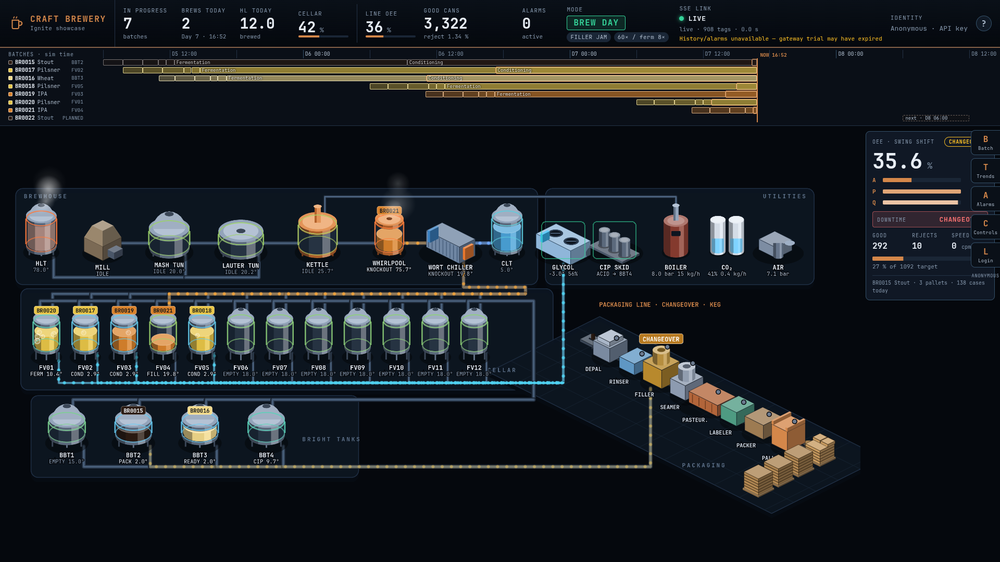
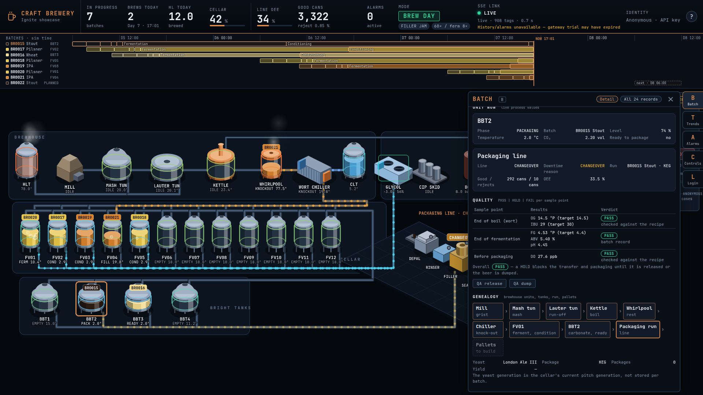
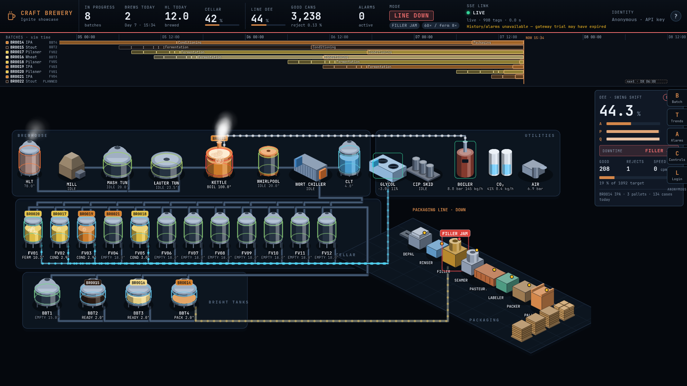
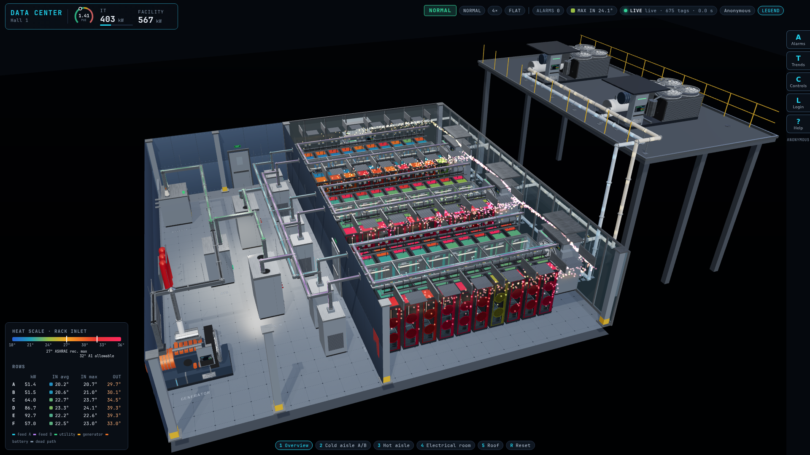
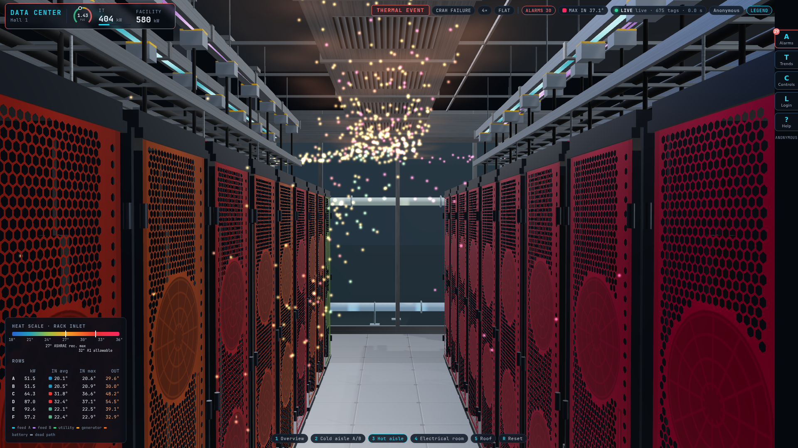
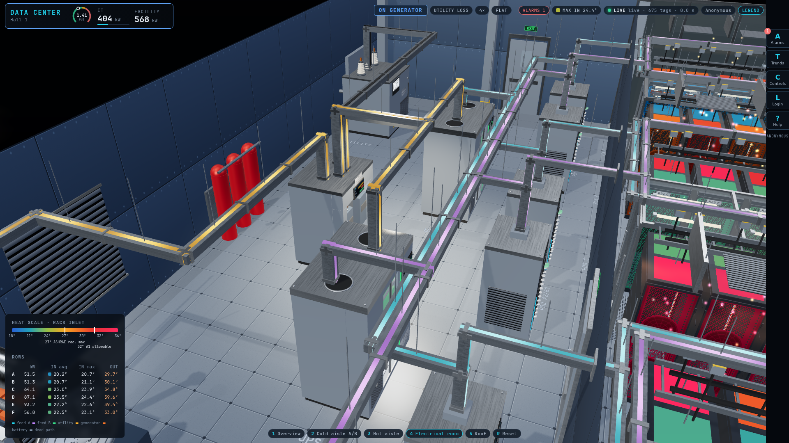
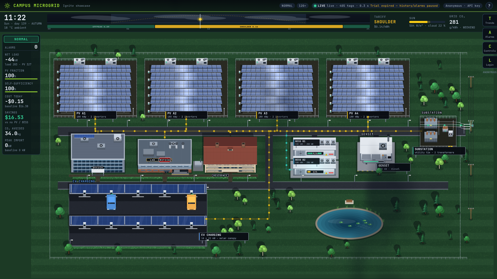
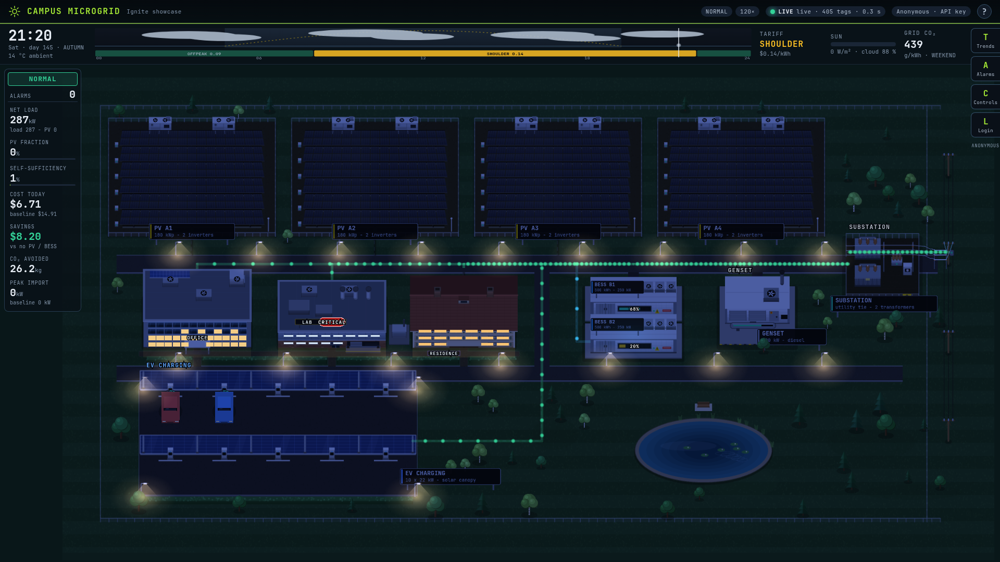
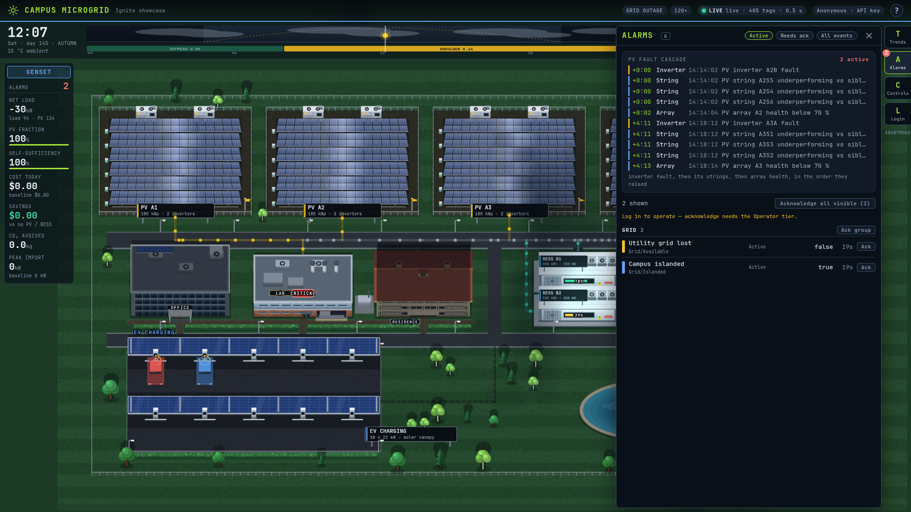

# Ignite Showcase

Demos that prove one idea: **any web technology, served by the Ignition gateway, with live access to every Ignition resource through [Ignite](https://github.com/EckmanTechLLC/ignite)** — tags, alarms, history, named queries, scripts, audit and tiered auth.

Each demo is a single full-viewport control-room screen on a different front-end stack, all sharing one framework-agnostic client.

## Layout

| Path | What |
|---|---|
| `shared/client/` | `@ignite/client` — TypeScript, zero runtime dependencies: env bootstrap, REST wrappers, SSE (folder subscriptions, initial snapshot, per-frame batching, reconnect), `systemStatus()` / `probeHealth()` licence and trial probe (`GET /system/status`; an optional history probe is the fallback for modules without the route); 0.2.0 adds optional `{signature, reason}` options on `writeTags`, `acknowledgeAlarm` and `callLibrary` (21 CFR Part 11 e-signatures, ADR-006) with `SignatureRequiredError` / `SignatureRejectedError`; 0.3.0 `subscribe()` accepts segment-wildcard patterns and registers long lists (URL over 6 000 characters, or `register: true`) via `POST /sse/subscriptions`, re-registering when the id expires, with `onError` for the server's error text |
| `shared/theme/` | CSS tokens, motion rules and bundled fonts (Inter, JetBrains Mono) |
| `launch/` | Demo 1 — Launch Operations: React 18, Vite, React Three Fiber, ECharts |
| `datacenter/` | Demo 2 — Data Center: Vue 3, Vite, TresJS 3D data hall (60 racks, CRAH airflow particles, live power path) |
| `microgrid/` | Demo 3 — Campus Microgrid: Svelte 5, Vite, PixiJS living campus map (scene: task-82; overlays: task-68) |
| `brewery/` | Demo 4 — Craft Brewery: SolidJS, Vite, PixiJS 8 isometric plant, batch Gantt strip, OEE tile and overlays: batch, trends, alarms, controls, identity, audit (task-73, task-74) |
| `scripts/deploy.mjs` | Builds every demo and commits the output to the `deploy` branch |
| `docs/ASSETS.md` | Every bundled third-party asset and its licence |
| `docs/perf.md` | Measured performance, Lighthouse scores and what was changed because of them |
| `docs/screenshots/` | Three screenshots per demo (used by the demo READMEs) |

`main` holds source only. The `deploy` branch holds built output only (`launch/`, `datacenter/`, `microgrid/`, `brewery/`); gateway site records point at it with `servePath=launch` / `servePath=datacenter` / `servePath=microgrid` / `servePath=brewery`.

## Screenshots

Demo 4, Craft Brewery (headless Chrome, 1920x1080, live data, software GL):

Demo 2, Data Center (detailed 3D hall; headless Chrome, 1920x1080, live data, software GL):

Demo 3, Campus Microgrid (oblique 2.5D campus map; headless Chrome, 1920x1080, live data):

Launch's screenshots are in `launch/README.md`.

## Build

    npm install && npm run build
    npm test

## Local development

Copy `.env.example` in a demo folder to `.env.development.local` (git-ignored; `vite build` never reads it, unlike `.env.local`, so the key cannot reach `dist/`), fill in the gateway URL, site and (read-tier) API key, then `npm run dev -w @ignite/launch` (or `@ignite/datacenter`, `@ignite/microgrid`, `@ignite/brewery`). In production the gateway injects `window.__IGNITE_ENV__`; nothing else is configuration.

## Deploy

    npm run deploy              # build + commit to local `deploy` branch
    npm run deploy -- --push    # also push `deploy`

Architecture and decisions: [ADR-005](https://github.com/EckmanTechLLC/ignite/blob/main/docs/decisions/adr-005-showcase-program.md).

## Status

The demos run against a lab Ignition gateway on a trial licence. Headless performance numbers are software-rendered, so they understate real GPU hardware (`docs/perf.md` explains). The `deploy` branch is build output: it is never force-pushed, but its history is noisy. There is no CI yet.

## License

MIT. Third-party assets: see `docs/ASSETS.md`.
