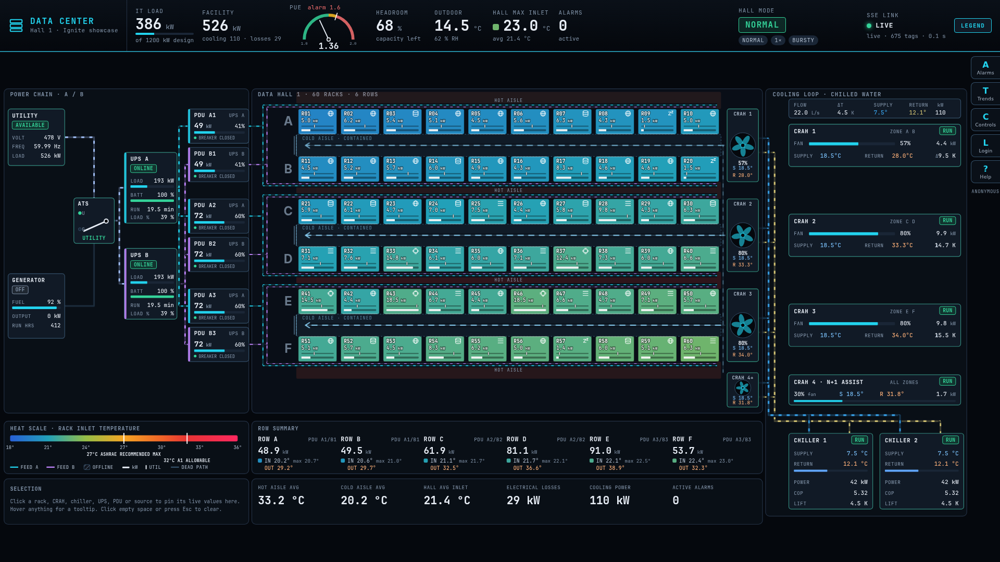
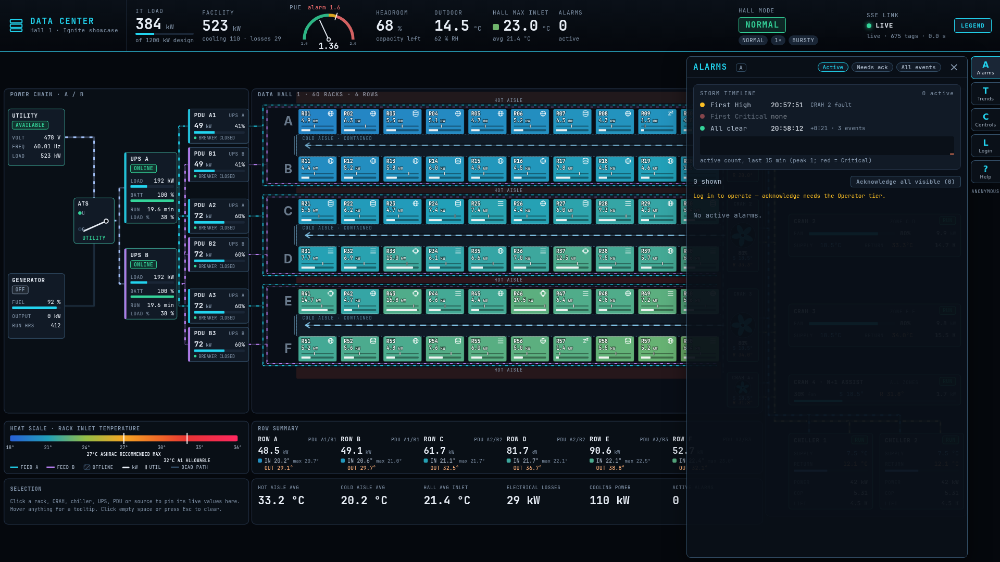
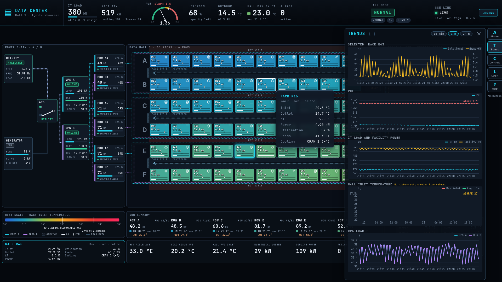

# Data Center (Vue 3)

3D data hall (Vue 3 + TresJS, task-80) bound to live `[default]DC/` tags (task-56) with the operating overlays (task-57):
alarm board, trends, scenario controls, login and audit. Served by the Ignite gateway at site `datacenter`; the
gateway injects `window.__IGNITE_ENV__` (gateway URL, site, read key, and `IGNITE_AUDIT_PROFILE` from the site's
`envVars`). Nothing else configures the page.

## Keys and panels

| Key | Panel | What it does |
|---|---|---|
| `A` | Alarms | `/alarms/status` every 3 s (paused while the tab is hidden); grouped by source (racks by row, UPS, PDU, CRAH, Hall); filters Active / Needs ack / All; per-row, per-group and all-visible acknowledge; storm timeline (first High, first Critical, all clear) and a 15 min active-count sparkline from the board's own samples. The HUD ALARMS tile pulses on Critical. |
| `T` | Trends | PUE (1.6 line), IT and facility kW, hall max/avg inlet, UPS A/B load; windows 15 min / 1 h / 24 h from history, then live append from the store; redraw at most 2 Hz. Clicking a rack, CRAH, UPS or PDU opens a "Selected" chart (rack inlet + kW, CRAH supply/return/fan, UPS load + SOC, PDU load). ECharts is a lazy chunk. |
| `C` | Controls | Utility loss/restore, fail/restore CRAH 1-4, start migration, workload profile, restore all (confirm); Director: speed 0.5/1/2/4 and raw scenario set. Mode, scenario and speed chips live in the header; each action toasts the library message and refreshes `dc.status()`. |
| `L` | Identity | Login, session tier chip, logout, audit view (Director). |
| `?` | Help | Shortcuts and the Ignite routes this page uses (`?about` in the URL opens it at load). |
| `1`-`5`, `R` | Camera | Presets: overview, cold aisle A/B walk-through, hot aisle, electrical room, roof; `R` resets. Idle overview orbits slowly; click an item to fly to it. |

`Esc` closes a panel or the selection. `?perf` in the URL shows the performance readout (always available in dev); `p` toggles it.

## Screenshots

Headless Chrome, 1920x1080, live data (these show the SVG hall of tasks 56-59; refreshed for the 3D hall in task-81).

## Performance

`?perf` readout: fps, frame time p50/p95/max, draw calls, triangles and live particle count, DOM nodes, SSE batches/s. Measurements: [`docs/perf.md`](../docs/perf.md).

The hall is detailed procedural equipment (task-84), kept to about 100 draw calls and 300-350 k triangles at rest: static equipment is merged per material (`hall3d/gfx.ts` `Batch`), racks, server units, LEDs, fans and breakers are instanced, and the status displays are one canvas atlas. Lighting is image-based (three's `RoomEnvironment`), one shadowed key light whose shadow map is rendered only at start (the casters are static), a light fog and ACES tone mapping. The ceiling grid hides and the return ducts turn see-through when the camera is above the cut-away. Reduced motion keeps all geometry and drops particles, fan spin, LED blinking and conductor pulses.

| Equipment | What it shows |
|---|---|
| Rack (60) | 42U cabinet, perforated front door (glows with inlet temperature), rear door with fan grills (glows with outlet temperature), 1U/2U/4U servers filled by kW, status and data LEDs (blink rate by kW), switch with port LEDs, side cable bundles, nameplate, inlet strip, kW bar, offline "zz" with red LED |
| Cold-aisle containment | Framed glass roof with strip lights, sliding glass end doors with handles, perforated floor tiles over a pedestal grid, hazard stripes |
| CRAH (4) | Cabinet, supply plenum, louvred filters, fan wheel behind a guard (spins at fan %), live display, status band and beacon, chilled-water stubs with valves, return duct from the ceiling |
| Chiller (2) | Screw chiller with motor, compressor, evaporator barrel, coil banks, four-fan condenser bank behind guards, control cabinet with display, insulated piping |
| UPS A/B | Rectifier, battery cabinet with cells behind glass (lit by state of charge), bypass breakers, display |
| PDU (6) | Breaker panel with toggles (down and red when tripped), load bar, display |
| ATS | Window onto two contactors and copper bus, transfer lever and position lamps, display |
| Generator | Engine with valve covers, alternator, radiator with spinning fan, muffler and stack (exhaust smoke and heat shimmer while running), fuel tank with level gauge, control panel |
| Utility entry | Switchgear with ceramic bushings, meter dial, conduits |
| Power and water | Busway ducts with flanged joints, hangers and tap-off boxes (a recessed light line pulses on the live path); insulated pipes with flanges, supports, valves and moving flow bands |

## Tiers

Role-generic names (ADR-005 section 7), derived from `/auth/session` `permissions`: Anonymous / Viewer (read) -> Operator
(`canWrite`: acknowledge, scenarios) -> Director (`canAdmin`: speed, raw scenario, audit). Disabled controls carry the
reason as their tooltip. A 401 on a call made with a stored token clears it and demotes to read-only (`onUnauthorized`).
The Director-only speed/raw-scenario controls are a UI gate: the server enforces only the write tier on `/script/library`.

### Identity states

The Identity panel (`L`) follows `/auth/session` `authMethod`:

- **Anonymous / Viewer (API key)** (`null`): login form.
- **Gateway session** (`web`): you are signed in to the Ignition gateway web UI in this browser; the gateway identifies you by that account and tiers come from its roles (raw `securityLevels` in the tooltip). No Log out is offered (`canLogout` is false); **Log in as a different user** opens the form, and the Bearer login then overrides the web session (ADR-004 section 1).
- **Bearer** (`bearer`): tier chip with **Log out** (and **Log out everywhere** under More). After logout the panel shows the Gateway session state if one exists, else the form.

## Feature matrix (every Ignite route)

| Route | Used by | Notes |
|---|---|---|
| `GET /tags/read` | n/a | No seed read and no constants poll: constants (rack Row/Feed/Workload, PDU Feed, CRAH Zone, Hall/CapacityKW) arrive in the SSE snapshot |
| `GET /sse` | `live/store.ts` | One connection on the folder pattern `[default]DC/**` (675 tags, 646 rendered), coalesced per frame |
| `GET /tags/history` | `overlays/trends/history.ts`, `live/store.ts` | Trends: | `returnSize` 90 / 120 / 144 for 15 min / 1 h / 24 h; values arrive as strings; nulls and implausible constants (|v| < 1e-6 or > 1e7) are dropped |
| `GET /tags/browse` | n/a | Tag paths are generated at build time from `sim/datacenter/tags.json`; there is nothing to discover at runtime |
| `POST /tags/write` | n/a | The scene is read-only; scenarios are steered through the `dc` library, which owns the `_Sim_` tags |
| `GET /system/status` | `live/store.ts` | Health probe (`probeHealth()`, on connect and every 60 s): `license.trialExpired` drives the "Trial expired - history/alarms paused" notice; in Trial mode the link chip's tooltip shows "Trial - 1 h 42 m left" |
| `GET /alarms/status` | `overlays/alarms/store.ts` | Filters other providers' alarms (`DC/` only) and the zero-length load artefacts (`activeTime == clearTime`) |
| `POST /alarms/acknowledge` | `overlays/alarms/store.ts` | One call per alarm id; write tier |
| `GET /alarms/history` | n/a | `/alarms/status` already carries cleared events with active/clear times, enough for the storm timeline |
| `POST /script/library` | `overlays/controls/dc.ts` | Project `demo`, `dc.status`, `set_scenario`, `restore`, `fail_crah`, `restore_crah`, `utility_loss`, `utility_restore`, `start_migration`, `set_workload_profile`, `set_speed` |
| `POST /script/system`, `GET /script/projects` | n/a | The demo calls named library functions only; raw `system.*` access is not needed and is the broader privilege |
| `POST /db/query` | n/a | The data center sim has no database; history comes from the tag historian |
| `POST /auth/login` | `identity/auth.ts` | 401 shown as a generic message, 429 as a lockout message |
| `GET /auth/session` | `identity/auth.ts` | `permissions` -> tier; `authMethod` / `canLogout` / `securityLevels` -> panel state and tooltip; refreshed after login, logout and on `unauthorized` |
| `POST /auth/logout` | `identity/auth.ts` | Server session invalidated (`{"loggedOut":n}`, optional `everywhere`), local token always cleared; 400 for non-bearer callers = nothing logged out |
| `GET /audit/logs` | `identity/IdentityPanel.vue` | Director only; last 30 min every 10 s, grouped by actor; profile from `__IGNITE_ENV__.IGNITE_AUDIT_PROFILE`, audit hidden when absent |
| `/sites*`, `/system/*` | n/a | Gateway administration, not an operator-facing function (the audit profile is set once through `PUT /sites/:id` `envVars`) |

## Development

    npm ci && npm run build -w @ignite/client
    cp datacenter/.env.example datacenter/.env.development.local   # set VITE_API_KEY to the site's read key
    npm run dev -w @ignite/datacenter

Use `.env.development.local`, never `.env.local` (Vite also reads that one for `vite build`, which would bake the key
into the deployed output). The dev server proxies `/data/ignite` to `DEV_PROXY_TARGET`; set `IGNITE_AUDIT_PROFILE` in
the browser (`window.__IGNITE_ENV__ = { IGNITE_AUDIT_PROFILE: '...' }`) to see the audit view in dev.

## Live connection

One SSE connection per page: `GET /sse?paths=[default]DC/**`. The gateway expands the folder once at connect (675 leaf tags, limit 1 000), sends every value as a snapshot (applied as one batch), then `event: subscribed` with the count, then changes; the HUD shows `live · N tags · data age`. Before the 20-minute connection cap it sends `event: reconnect` and the client reopens at once (fresh snapshot, no polling needed). The gateway allows at most 64 live streams in total; beyond that it answers HTTP 503 `{"error":"too many live connections"}`, so every open tab costs one slot. Tags added to the folder later appear after the next reconnect. `test/paths.test.ts` asserts the pattern URL stays under 1 000 chars.

The HUD link tile reads LIVE / STALE (no data for 10 s) / CONNECTING / RECONNECTING, and shows "Trial expired - history/alarms paused" when `GET /system/status` reports `license.trialExpired` (the 2-hour trial stops the historian and alarms while tags keep moving); while a trial runs the tile's tooltip reads "Trial - 1 h 42 m left".
