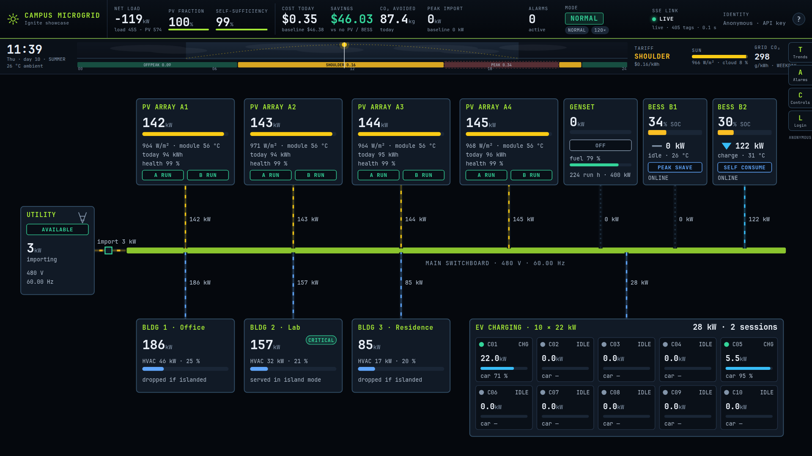
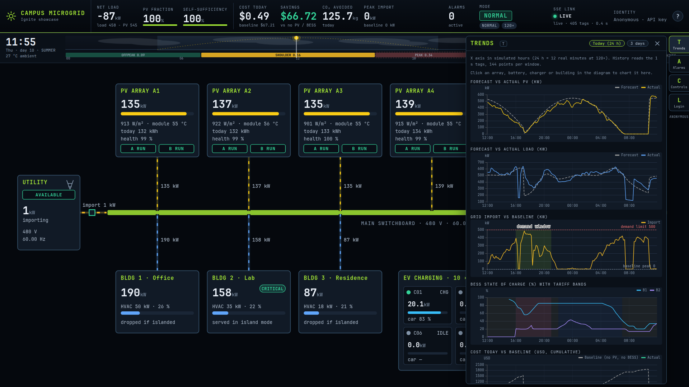
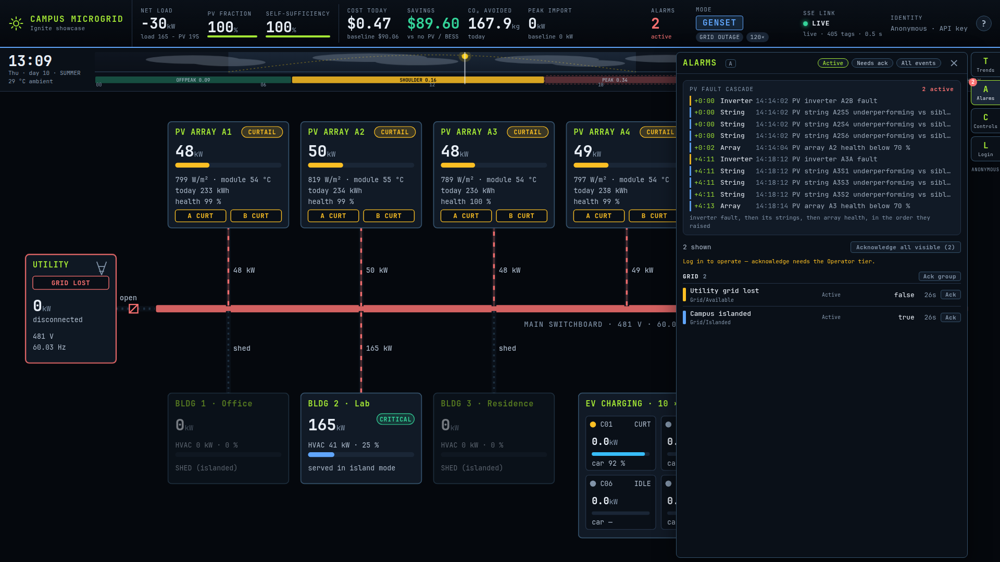

# Campus Microgrid (Svelte 5)

Full-viewport animated single-line diagram bound to the live `[default]MG/` tags (task-67; ADR-005 Amendment A1).
Served by the Ignite gateway at site `microgrid`; the gateway injects `window.__IGNITE_ENV__`. Overlays (trends,
alarms, dispatch and scenario controls, identity panel, audit) were added in task-68.

## What is on screen

- **Single-line diagram** (`src/diagram/`, SVG): utility intertie (available / islanded, V and Hz), main switchboard, 4 PV arrays
  (hover expands to 2 inverters x 6 strings with health; curtailment shown on the card), 2 BESS (SOC, kW direction, mode, temperature),
  genset (state, start countdown, fuel), 10 EV chargers as a bank, 3 buildings (kW, HVAC share, critical badge, shed).
  Conductor dashes run as Web Animations: direction follows the power, speed follows |kW|, dead paths stop; colour is import amber,
  export green, island red, genset grey. Island mode re-routes the picture; faults pulse. Hover shows a live tooltip, click selects
  (`selection.svelte.ts`; opens Trends on that element), `Esc` clears.
- **Day strip** (`src/strip/`): sun arc and cloud layer from `Time/*`, time-of-use band with the hour marker and the demand window.
- **HUD** (`src/hud/`): net load, PV fraction, self-sufficiency, cost / savings / CO2 / peak ticker (numbers roll), mode badge,
  scenario and speed chips, alarm count, SSE link chip (live / stale / connecting / reconnecting, tag count, data age, trial notice),
  identity chip (anonymous / gateway session / bearer); the alarm tile and the identity chip open their panels, the alarm tile pulses while a Critical alarm is active.
- `?perf` in the URL shows the performance readout (always in dev); `P` toggles. `?` or `?about` opens help.

## Overlays (right dock; keys T / A / C / L, `Esc` closes help, then the selection, then the panel)

- **Trends (T)**, `src/overlays/trends/`: Forecast vs actual PV, Forecast vs actual load, Grid import with the demand-limit and baseline-peak lines and the demand window shaded, BESS SOC with the tariff bands shaded, Cost today vs baseline. Windows: Today (the last 12 real minutes = 24 simulated hours) and 3 days (36 real minutes); `returnSize` 144. The x axis is in **simulated hours** (weekday on the 3-day view): history is stored against wall-clock time and mapped with the live `Time/DayIndex`, `Time/HourOfDay` and `_Sim_/SpeedFactor` tags, so a speed change or `set_hour` bends the older part of the window. Live values are appended once per history bucket (5 s) and a chart redraws only when a point was added or aged out (every 5 s), not at the 500 ms poll. Clicking an element in the diagram adds its charts on top: array (array AC/DC, the two inverters, six strings), BESS (SOC, kW, cell temperature), charger (kW and car SOC; SOC is not historized, so it fills live), building (kW, HVAC), plus EV bank, genset and utility. ECharts is a lazy chunk, loaded when the first chart mounts.
- **Alarms (A)**: grouped by subsystem (PV array, BESS, Grid, Genset, EV, Loads); priority, state, label, live value, age; filters Active / Needs ack / All events; acknowledge per row, per group and all visible (write tier, disabled with the reason otherwise). The PV fault cascade (inverter, strings, array health) is drawn as a timeline with offsets from the first event. Zero-length Cleared/Acknowledged load artefacts (`activeTime == clearTime`) are dropped.
- **Controls (C)**: Operator tier: BESS mode per container, Grid outage / restore, Inverter fault A_n_-A/B and Clear, Curtail PV (array, kW, release), EV smart charging, Cloudiness (slider, Auto), Jump to hour. Director tier: scenario (`normal`, `grid_outage`, `cloud_front_ev_rush`, `peak_shave_day`, `inverter_fault`) and speed (30 / 60 / 120 / 240). Each action toasts the library `message` and refreshes `mg.status()`; anonymous and Viewer see the live state with "Log in to operate".
- **Login (L)**: three states: nobody (Viewer by API key, login form), Gateway session ("Gateway session · user" and "Log in as a different user"), Bearer (tier chip, Log out, Log out everywhere). Audit view for Director: last 30 minutes of the audit profile named by `__IGNITE_ENV__.IGNITE_AUDIT_PROFILE`, grouped by actor, every 10 s; hidden when the profile is absent.
- Reduced motion: flows stop, numbers jump instead of rolling, CSS motion tokens go to 0.

## Screenshots

Headless Chrome, 1920x1080, live data (software-rendered, so only the look is representative).

## Performance

`?perf` shows a readout (fps, frame time p50/p95/max, DOM nodes, SSE batches/s, updates/s); `P` toggles it. Measurements: [`docs/perf.md`](../docs/perf.md).

## Connection model

One SSE connection on the folder pattern `[default]MG/**` (405 tags). The server answers with `event: subscribed` (count) and the client
delivers the initial snapshot as one batch, applied in one pass to a reactive map (`src/live/store.svelte.ts`). `src/live/paths.ts` and
`units.ts` are generated from `sim/microgrid/tags.json` (`npm run gen`, run by `dev`, `build` and `test`). Health probe: a 6-row history
request for `KPI/NetLoadkW` every 60 s; all nulls means the gateway trial expired (history and alarms stop, tags keep moving).

## Development

Copy `.env.example` to `.env.development.local` (git-ignored; never `.env.local`), then `npm run dev -w @ignite/microgrid`.
`npm run check` runs `svelte-check`; `npm run build` includes it. The audit view needs the profile name from the gateway (`window.__IGNITE_ENV__.IGNITE_AUDIT_PROFILE`, from the site's `envVars` `{"IGNITE_AUDIT_PROFILE":"<profile>"}`); in dev, set that global in the browser console to see it.

## Feature matrix

| Route | Tier | Used in |
|---|---|---|
| `GET /sse` | key | `live/store.svelte.ts`: one connection on `[default]MG/**` (405 tags), snapshot then changes |
| `GET /tags/read` | key | n/a: the SSE stream opens with a snapshot of every subscribed tag |
| `GET /tags/browse` | key | n/a: names are generated from `sim/microgrid/tags.json` at build time (`scripts/gen-paths.mjs`) |
| `GET /tags/history` | key | Health probe (`live/store.svelte.ts`, `KPI/NetLoadkW`, every 60 s) and every Trends chart (`overlays/trends/history.ts`, `returnSize` 144) |
| `POST /tags/write` | write | n/a: every state change goes through the `mg` library, which owns the `_Sim_` tags; a Viewer gets 403 (curl matrix) |
| `GET /alarms/status` | key | Alarm board and HUD tile (`overlays/alarms/store.svelte.ts`), polled every 3 s, paused while the tab is hidden |
| `GET /alarms/history` | key | n/a: the lab has no alarm journal (the launch and datacenter demos do not use one either) and `/alarms/status` already carries cleared events with active and clear times, enough for the cascade timeline; the history tab is therefore not offered |
| `POST /alarms/acknowledge` | write | Alarm board: per row, per group, all visible |
| `GET /script/projects` | key | n/a in the UI (the project is fixed to `demo`); checked in the curl matrix |
| `POST /script/library` | write | Controls: `mg.status/set_mode/grid_outage/grid_restore/inverter_fault/curtail_pv/ev_smart/set_cloudiness/set_hour/set_scenario/set_speed` |
| `POST /script/system` | write | n/a: the library is the whole command surface |
| `POST /auth/login` | none | Login panel; 401 is a generic message, 429 a lockout message |
| `GET /auth/session` | token | Tier, panel state (`authMethod`, `canLogout`, `securityLevels`); refreshed after login, logout, on `unauthorized` and when the tab becomes visible |
| `POST /auth/logout` | token | Login panel: Log out / Log out everywhere; 400 for non-bearer callers is treated as nothing logged out |
| `GET /audit/logs` | admin | Login panel, Director only (`overlays/identity/audit.svelte.ts`) |
| `POST /db/query` | key | n/a: the microgrid has no database; history comes from the tag historian |
| `/sites*`, `/system/*` | admin | n/a: gateway administration (the audit profile is set once through `PUT /sites/:id` `envVars`) |

The site is scoped to `[default]MG/**`: every tag path the page touches is under it; a path outside it (for example `[default]Launch/Clock/Phase`) is 403 with the microgrid key.
